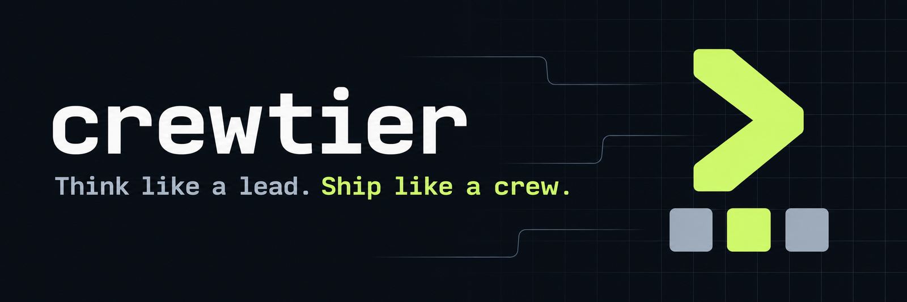
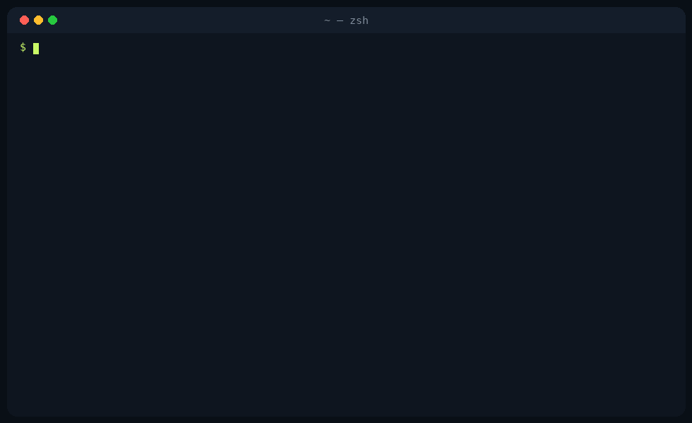

<p align="center">
  
</p>

<h3 align="center">Think like a lead. Ship like a crew.</h3>

<p align="center">
  Your coding agent plans and reviews. The other coding agents on your machine write the code.
</p>

<p align="center">
  <a href="https://www.npmjs.com/package/@noxhsxrk/crewtier"></a>
  <a href="LICENSE"></a>
  
  
</p>

<p align="center">
  <a href="#features">Features</a> ·
  <a href="#quick-start">Quick start</a> ·
  <a href="#how-it-works">How it works</a> ·
  <a href="#does-it-save-anything">Does it save anything?</a> ·
  <a href="#changing-things-later">Changing things later</a> ·
  <a href="#safety">Safety</a> ·
  <a href="#commands">Commands</a> ·
  <a href="docs/reference.md">Reference</a>
</p>

---

**crewtier** is a skill plus a small CLI that lets the coding agent you talk to (Claude Code, Codex, opencode, Gemini, Antigravity, Copilot, Cursor, and more) hand big, already-decided coding tasks to the *other* agent CLIs on your machine, in one call per task. The aim is to spend less of your main agent's tokens and quota. Whether it does depends on task size: see [Does it save anything?](#does-it-save-anything).

## Features

- **One call per task.** `crewtier do` saves the spec, runs the worker, checks the result, retries one tier up if it fails, and commits on success. The lead spends one turn on it.
- **Any agent can lead.** 18 leads supported. Every other installed agent CLI is a worker. crewtier knows about 45 agent CLIs, and `crewtier agents add` wires up any other one.
- **Tiered routing.** Easy tasks go to a fast, cheap model; hard ones to a strong model; risky ones stay with the lead.
- **Live model lists.** Model names come straight from each CLI (`codex debug models`, `agy models`, `opencode models`), so the lead never guesses a name.
- **Sign-in and quota checks.** Every session starts by checking who is signed in and who still has quota. `crewtier login` fixes the rest.
- **Verified results.** Each task has a check command. A worker's "done" has to show up in git and pass the test.
- **Clean fallback.** If a worker runs dry or fails, crewtier saves its partial patch, resets, and tries the next one.
- **Measured, not assumed.** `crewtier bench` and `crewtier session` show whether delegating saved anything on your own work. Results so far are below, including the bad ones.

## Quick start

Install with any one of these. `init` opens a short arrow-key checklist: it shows which agent CLIs are signed in, lets you sign in to the others (press `s`), lets you switch off the ones you don't want as workers, and then asks which leads to install the skill for.

```bash
npx @noxhsxrk/crewtier@latest init
```

```bash
pnpm dlx @noxhsxrk/crewtier@latest init
```

```bash
bunx @noxhsxrk/crewtier@latest init
```

```bash
curl -fsSL https://raw.githubusercontent.com/noxhsxrk/crewtier/main/install.sh | bash -s -- init
```

> [!TIP]
> Keep `@latest`. Without it, npx can reuse an older copy from its cache. To update later, run `crewtier update`.

<p align="center">
  
</p>

Then open your agent in a repo:

1. Say **"set up crewtier"**. The lead lists your workers, proposes a tier table, and saves it once you agree.
2. Ask for a big feature as usual. The lead does small work itself and delegates large, well-specified tasks.

See [a day with crewtier](docs/walkthrough.md) for what that looks like.

## How it works


```bash
crewtier do t2-normal --commit "Add crumbling platforms" <<'EOF'
Add crumbling platforms from level 31: generator, builder and server script.
Done when: selene src && rojo build -o check.rbxlx
EOF
# D1 PASS codex/gpt-6.1-sol · 412 lines (5 files) · 3m10s · commit abc123
```

`crewtier do` picks the first worker in the tier that is installed, signed in and has quota, gives a failing worker one fix round, moves up a tier if it still fails, and commits only when the check passes and the tree was clean.

| Tier | Typical task | Goes to |
|---|---|---|
| `t1-easy` | boilerplate, tests, docs | fast, cheap model |
| `t2-normal` | a feature across a few files with a clear spec | solid mid model |
| `t3-hard` | tricky logic, cross-module refactors | strongest coding model |
| `lead` | small edits, unclear bugs, design, security-sensitive code | the lead itself |

## Does it save anything?

It depends on task size, and we publish the numbers either way. All runs: `crewtier bench`, same task from the same commit done twice (lead alone vs with crewtier), Claude Opus as lead, real tasks from a Roblox project. Worker costs are not included: they come out of the workers' own plans.

| Round | crewtier version | Large task (~500 lines) | Mid (~130–200) | Small (~50) |
|---|---|---|---|---|
| 1 (10 runs) | before `crewtier do` | 104–111% of alone, in dollars | 112–124% | 164–194% |
| 2 (5 runs) | 0.1.10, with `crewtier do` | **60–66%** | 100–103% (lead did it itself) | 114% (lead did it itself) |

What changed between the rounds: delegating became one call (`crewtier do`), the skill tells the lead to keep anything under ~300 lines to itself, and the skill text is a quarter of its old size. The large task flipped to cheaper even though a bug (since fixed) made the lead re-check the worker's result by hand. Still true: delegated tasks are slower (about 3 times here), and two runs per task is a small sample.

Measure it on your own work with `crewtier bench` (lead tokens, turns and dollars for both sides, plus both diffs) and `crewtier session` (where the current conversation's cost went).

## Changing things later

You never need to run `init` again. Open the menu:

```bash
crewtier
```

<p align="center">
  
</p>

Use up/down to move, **space** to pick, **enter** to confirm, **q** to go back.

- **Workers:** turn workers on or off, and press `s` to sign in to the highlighted one.
- **Add agents:** lists agent CLIs on your machine that aren't set up yet. Just signed up for a new one? Install its CLI, then pick it here.
- **Routing:** for each tier, a checklist of every model your workers offer, read live from each CLI. `f` moves a model to the top, `e` sets its effort, `m` adds a model by hand.

After you add a worker, crewtier prints a prompt to paste into your lead so it rebuilds the tiers with the new models:

> I just added grok to crewtier. Run `crewtier health --force` and `crewtier agents --models`, then propose a new tier table for my routing file using only the model names those commands list. […] wait for my OK before saving.

Prefer plain commands? These do the same job:

```bash
crewtier agents add grok                            # a CLI crewtier already knows
crewtier agents add my-agent --headless 'my-agent exec --model {model} {prompt}'
crewtier routing add t1-easy codex gpt-6-luna --first
crewtier disable opencode
```

## Safety

> [!WARNING]
> Workers run with approvals bypassed, because headless runs would otherwise hang. Work on a clean git tree and review every diff before you commit.

- **Repo copies fail closed.** A skill copied into a repo refuses to run until you approve its exact contents with `crewtier trust`.
- **Your tree is only reset when it was clean** at the start of the task, and every discarded attempt is saved as a patch first.
- **Workers billed per API call stay off** unless you allow them.
- **No telemetry**, no network calls of its own, no credentials touched. Each worker uses its own sign-in.

> [!NOTE]
> Sending company code to an agent signed in with a personal account may break your employer's rules. Keep only the allowed workers in that repo's routing.

## Commands

You mostly use these. The lead calls the rest for you.

| Command | What it does |
|---|---|
| `crewtier init` | check sign-ins, then install the skill for the leads you choose |
| `crewtier setup` (or just `crewtier`) | menu to sign in, turn workers on or off, add newly installed agents, and pick the models for each tier |
| `crewtier update` | update to the latest release |
| `crewtier login [agent]` | sign in to an agent CLI and re-check it |
| `crewtier routing [add\|remove\|first\|edit]` | see or change which agent and model each tier uses |
| `crewtier agents add <bin>` | use another agent CLI as a worker |
| `crewtier disable <agent>` | never use a worker (`enable` turns it back on, `workers` lists them) |
| `crewtier health [--verbose]` | which workers are signed in and have quota; `--verbose` shows why one failed |
| `crewtier doctor` | check the whole install |

Full list of commands, options and environment variables: [reference](docs/reference.md#cli-reference).

## Docs

- [A day with crewtier](docs/walkthrough.md): an example session from request to commit
- [Reference](docs/reference.md): concepts, the routing file, `run` internals, health checks, measuring savings, install scopes, CLI, environment variables, FAQ

> [!NOTE]
> crewtier is new and has mostly been tested against stand-in CLIs. Agent CLIs change their flags often, so if a worker fails, run `crewtier health --verbose` and open an issue with the output.
