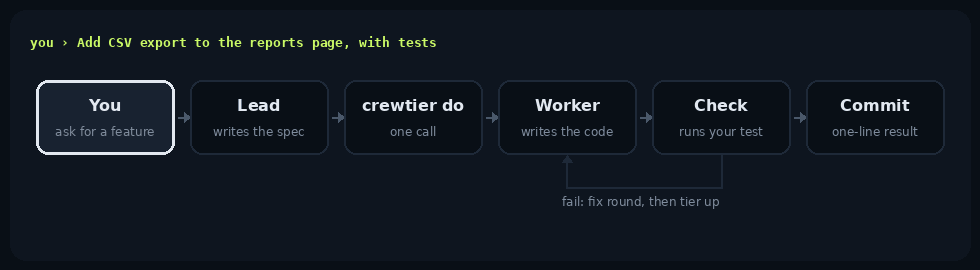
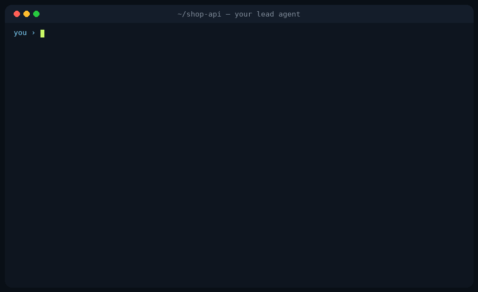
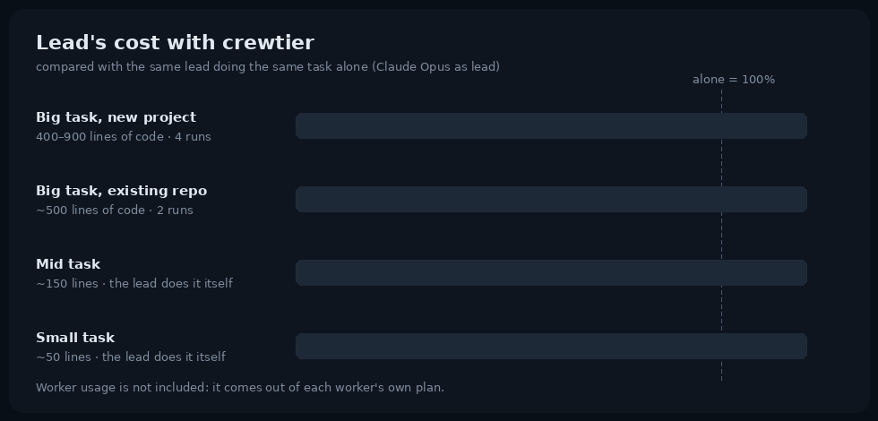
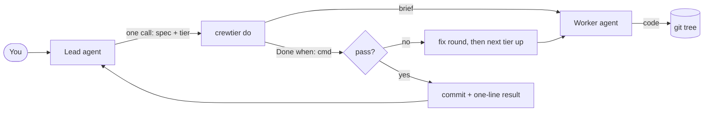

<p align="center">
  
</p>

<h3 align="center">Think like a lead. Ship like a crew.</h3>

<p align="center">
  The coding agent you talk to keeps the thinking.<br>
  The other agent CLIs on your machine do the typing.
</p>

<p align="center">
  <a href="https://www.npmjs.com/package/@noxhsxrk/crewtier"></a>
  <a href="LICENSE"></a>
  
  
  
</p>

<p align="center">
  <a href="#why">Why</a> ·
  <a href="#quick-start">Quick start</a> ·
  <a href="#what-a-session-looks-like">A session</a> ·
  <a href="#how-much-it-saves">How much it saves</a> ·
  <a href="#how-it-works">How it works</a> ·
  <a href="#changing-things-later">Changing things later</a> ·
  <a href="#safety">Safety</a> ·
  <a href="#commands">Commands</a>
</p>

---

## Why

Most of what a coding agent costs you isn't the thinking. It's the typing: the hundreds of lines it writes out token by token, and the whole conversation it re-reads on every turn while doing so.

**crewtier** is a skill plus a small CLI. It lets the agent you talk to (Claude Code, Codex, opencode, Gemini, Antigravity, Copilot, Cursor, and more) hand a big, already-decided task to one of the *other* agent CLIs installed on your machine, in one call, and get back one line when the check passes. Your lead spends its tokens on the plan, the spec and the review. The worker spends its own plan's quota on the keystrokes.

<p align="center">
  
</p>

- **One call per task.** `crewtier do` saves the spec, runs the worker, runs your check, gives a failing worker one fix round, moves up a tier if it still fails, and commits on success.
- **Small work stays with the lead.** Anything under about 300 lines is cheaper to do in place. The lead knows that from a three-line note in its own rules file, so it never loads the skill for small tasks.
- **Verified, not trusted.** Every spec ends with `Done when: <command>`. A worker's "done" has to show up in git and pass that command.
- **Any agent can lead; any agent can work.** 18 leads. crewtier knows 45 agent CLIs out of the box, reads their model lists live, and `crewtier agents add` wires up any other one.
- **Measured, not assumed.** `crewtier bench` and `crewtier session` show whether it saved anything on *your* work. The numbers below include the runs where it didn't.

## Quick start

Pick one. `init` opens an arrow-key checklist: which agent CLIs are signed in, which to use as workers, which leads get the skill.

```bash
npx @noxhsxrk/crewtier@latest init
```

```bash
pnpm dlx @noxhsxrk/crewtier@latest init
```

```bash
bunx @noxhsxrk/crewtier@latest init
```

```bash
curl -fsSL https://raw.githubusercontent.com/noxhsxrk/crewtier/main/install.sh | bash -s -- init
```

<p align="center">
  
</p>

> [!TIP]
> Keep `@latest`, or npx may reuse an older copy from its cache. Later, `crewtier update` does the rest.

Then open your agent in any repo and say **"set up crewtier"**. It lists your workers and their models, proposes a tier table, and saves it once you agree. From then on, just ask for features as usual.

## What a session looks like

<p align="center">
  
</p>

The lead decides by size. A rename is done in place. A new export feature with tests becomes a spec file and one command:

```bash
crewtier do t2-normal --spec .crewtier/specs/export.md --commit "Add report export"
# … D1 codex/gpt-6.1-sol still running (3m)
# D1 PASS codex/gpt-6.1-sol · 412 lines (5 files) · 4m02s · commit 4e1c2ab
```

On `PASS` the lead reports it and moves on without reading the diff: the check already ran. See [a day with crewtier](docs/walkthrough.md) for a longer example.

## How much it saves

Measured with `crewtier bench`: the same task, from the same commit, done twice by Claude Opus as lead, once alone and once with crewtier. Workers were Codex and Gemini CLIs on their own plans.

<p align="center">
  
</p>

| Task | Lead's cost with crewtier | What happened |
|---|---|---|
| Big task, new project (400–900 lines of code) | **~70% less** | one `do` call, passed first time, 4 of 4 runs |
| Big task, existing repo (~500 lines) | **~37% less** | one `do` call; the lead first read the code to write the spec |
| Mid task (~150 lines) | about the same | the lead did it itself |
| Small task (~50 lines) | up to 10% more | the lead did it itself |

What to keep in mind:

- **Savings come from big, decided tasks.** The lead's cost is mostly output tokens and re-reading the conversation; handing the typing off removes both. For anything smaller, the lead works as usual and crewtier costs almost nothing.
- **New projects save the most** because the lead has nothing to read before writing the spec. In an existing repo it still has to understand the code first.
- **Workers take longer.** A delegated task took about 2.5–4× the wall-clock time of the lead doing it, because the worker's model writes more slowly. You wait longer and pay less.
- **Worker usage isn't counted.** It comes out of each worker's own plan. Only the lead's bill is in the chart.
- **Small sample.** Two runs per task. The worker's version of the big task was also leaner (fewer tests in 3 of 4 runs), which the check can't tell you about. Run `crewtier bench` on your own work before trusting any of this.

```bash
crewtier bench --lead claude --task "Add CSV export to the reports page, with tests" --test "pnpm test"
crewtier session      # the lead's cost per line shipped in the current conversation
```

## How it works



Size decides *whether* to delegate. Difficulty decides *which tier*:

| Tier | Typical task | Goes to |
|---|---|---|
| `t1-easy` | big but mechanical: many tests, boilerplate, docs, repeated edits across files | fast, cheap model |
| `t2-normal` | a feature with a clear spec | solid mid model |
| `t3-hard` | tricky logic, cross-module refactors | strongest coding model |
| `lead` | small edits, unclear bugs, design, auth and security code | the lead itself |

Each tier lists the workers and models to try, in order. `crewtier do` takes the first one that is installed, signed in and has quota. If a worker runs dry or breaks, its partial patch is saved, the tree is reset, and the next one goes. If the check fails after the fix round, the task moves up a tier on its own.

A spec is a short markdown brief. The lead writes it from what you asked for, not from reading the code:

```markdown
Add CSV and PDF export to the reports page.
- `GET /reports/:id/export?format=csv|pdf`, same filters as the page
- button next to "Print", disabled while generating
- tests for both formats and for an unknown format (400)
Done when: `pnpm test reports`
```

## Changing things later

You never run `init` again. Open the menu:

```bash
crewtier
```

<p align="center">
  
</p>

Up/down to move, **space** to pick, **enter** to confirm, **q** to go back.

- **Workers:** turn workers on or off; `s` signs in to the highlighted one.
- **Add agents:** agent CLIs on your machine that aren't set up yet. Just subscribed to a new one? Install its CLI, then pick it here.
- **Routing:** per tier, a checklist of every model your workers offer, read live from each CLI. `f` moves a model to the top, `e` sets its effort, `m` adds one by hand.

After you add a worker, crewtier prints a prompt to paste into your lead so it rebuilds the tiers around the new models. Prefer plain commands? These do the same:

```bash
crewtier agents add grok                            # a CLI crewtier already knows
crewtier agents add my-agent --headless 'my-agent exec --model {model} {prompt}'
crewtier routing add t1-easy codex gpt-6-luna --first
crewtier disable opencode
```

## Safety

> [!WARNING]
> Workers run with approvals bypassed, because headless runs would otherwise hang. Work on a clean git tree and review before you merge.

- **The tree is only reset when it was clean** at the start of a task, and every discarded attempt is saved as a patch first.
- **Repo copies fail closed.** A skill copied into a repo refuses to run until you approve its exact contents with `crewtier trust`.
- **Workers billed per API call stay off** unless you allow them.
- **No telemetry**, no network calls of its own, no credentials touched. Each worker uses its own sign-in.

> [!NOTE]
> Sending company code to an agent signed in with a personal account may break your employer's rules. Keep only the allowed workers in that repo's routing.

## Commands

You mostly use these. The lead calls the rest.

| Command | What it does |
|---|---|
| `crewtier init` | check sign-ins, then install the skill for the leads you choose |
| `crewtier` (or `crewtier setup`) | menu: sign in, turn workers on or off, add new agents, pick models per tier |
| `crewtier do <tier> --spec <file>` | hand one task to a worker, verify, commit; what the lead calls |
| `crewtier update` | update to the latest release and refresh every lead's rules block |
| `crewtier login [agent]` | sign in to an agent CLI and re-check it |
| `crewtier routing [add\|remove\|first\|edit]` | see or change which agent and model each tier uses |
| `crewtier agents add <bin>` | use another agent CLI as a worker |
| `crewtier disable <agent>` | never use a worker (`enable` turns it back on, `workers` lists them) |
| `crewtier health [--verbose]` | which workers are signed in and have quota |
| `crewtier bench` / `crewtier session` | measure what delegating saves on your own work |
| `crewtier doctor` | check the whole install |

Everything else, with options and environment variables: [reference](docs/reference.md#cli-reference).

## Docs

- [A day with crewtier](docs/walkthrough.md): a session from request to commit
- [Reference](docs/reference.md): concepts, the routing file, `do` and `run` internals, health checks, measuring, install scopes, CLI, environment variables, FAQ

> [!NOTE]
> crewtier is new. Agent CLIs change their flags often, so if a worker fails, run `crewtier health --verbose` and open an issue with the output.
